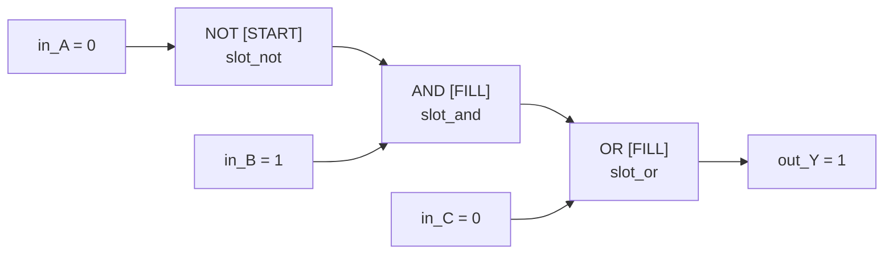
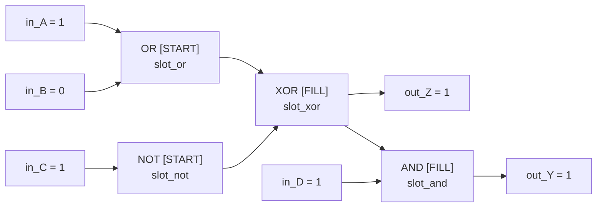
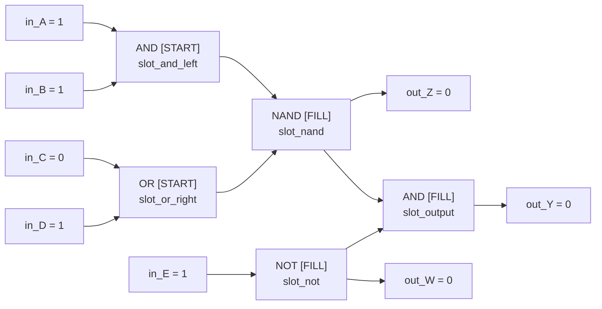
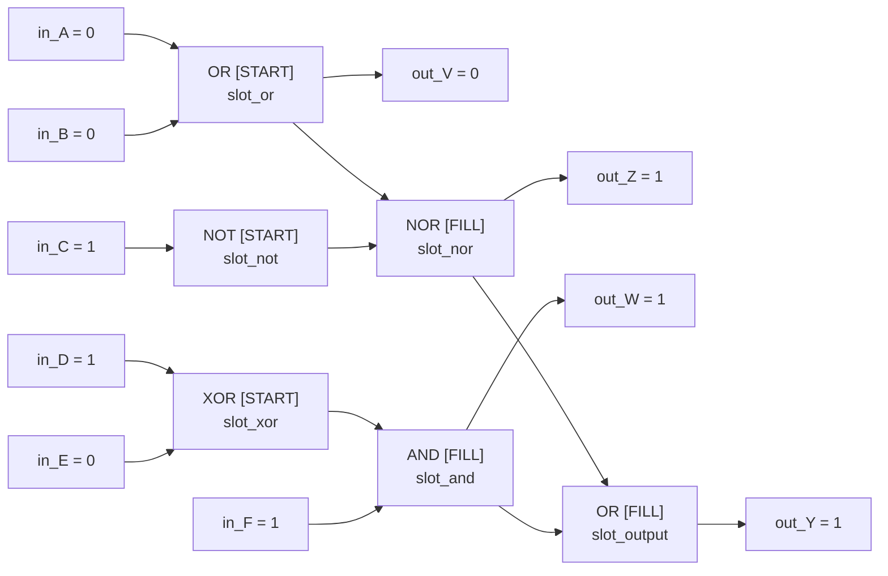
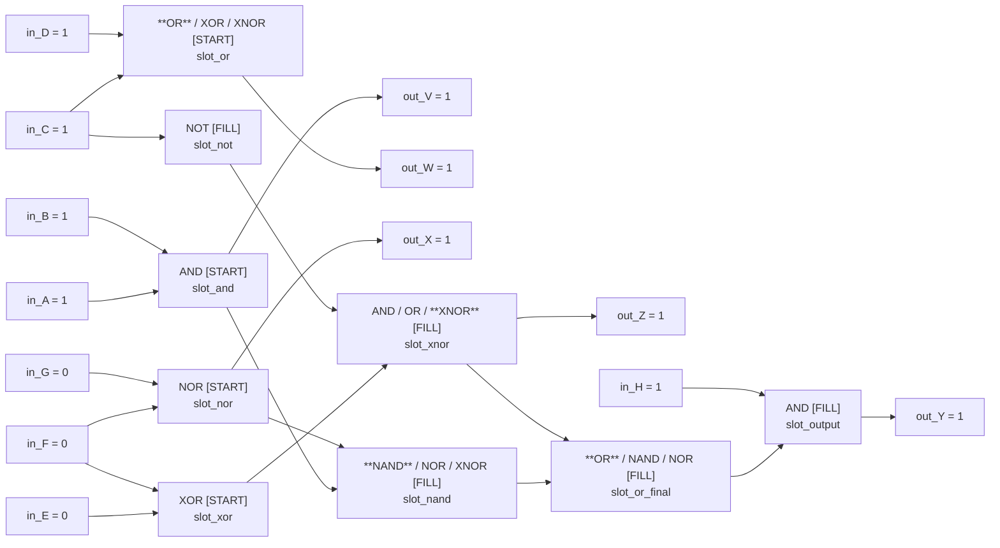
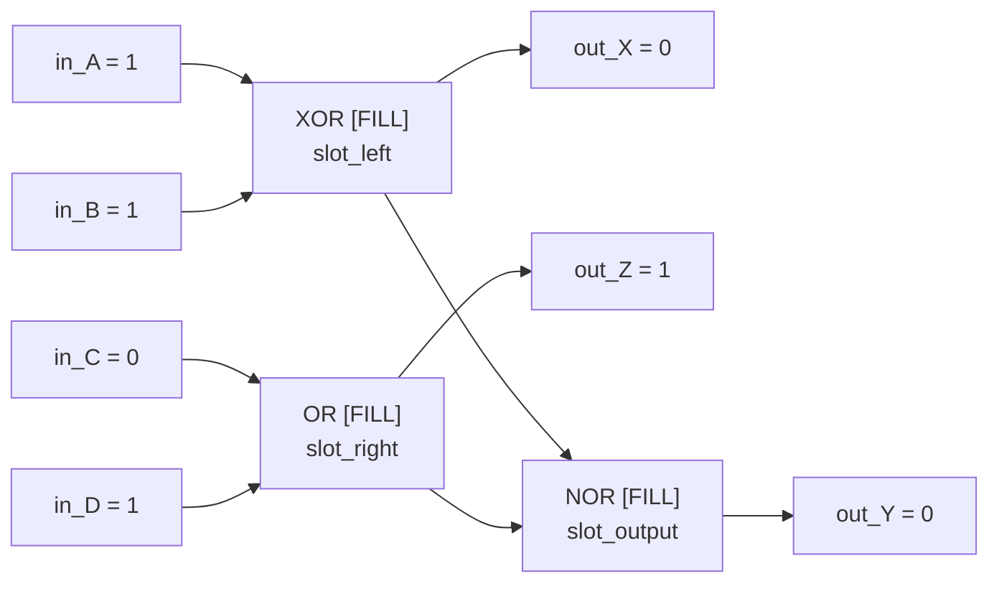
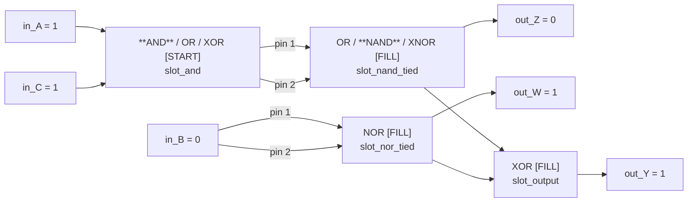
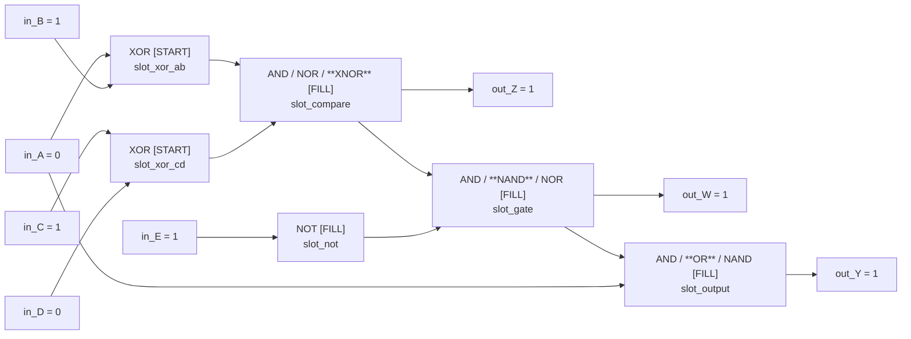
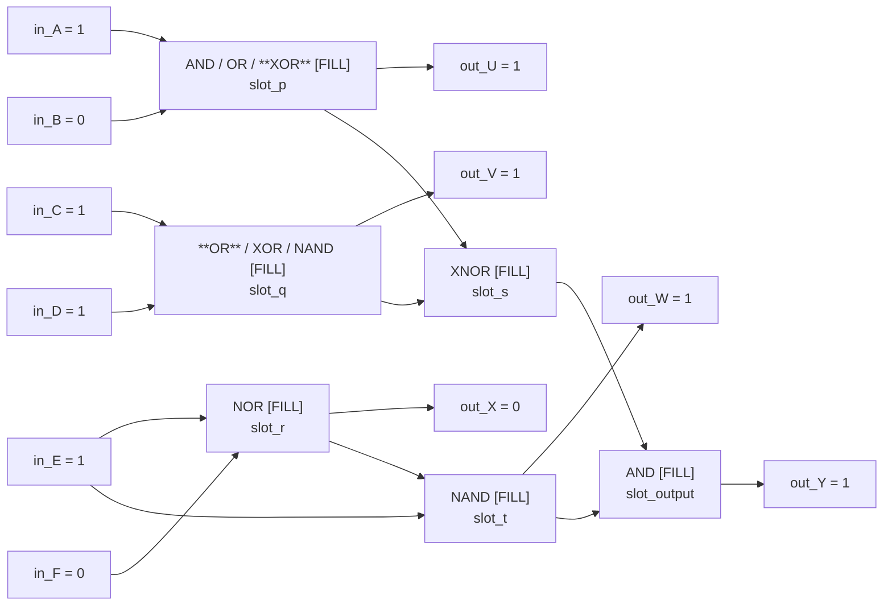
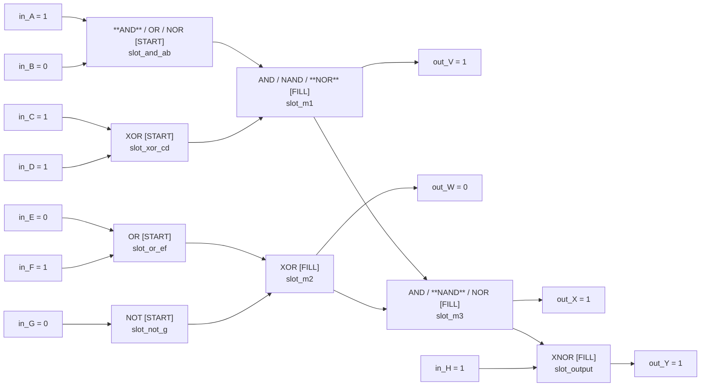

# Level Circuit Diagrams

These diagrams show the intended circuit wiring for each level. `[START]`
means the gate is already placed when the level begins. `[FILL]` means the
slot starts empty. Most slots accept any gate with the right number of inputs,
so the player can place a wrong gate; a level is solved when every output light
matches its target. Players can also replace `[START]` gates. Where a label
lists several gates, that slot accepts only those, and the intended gate is in
bold. Some levels have more than one solution. Every output light is a declared target, including intermediate
outputs.

## Level 1: Logic Gate Foundations

Inputs: `in_A=0`, `in_B=1`, `in_C=0`  
Target: `out_Y=1`

## Level 2: Spot the Difference

Inputs: `in_A=1`, `in_B=0`, `in_C=1`, `in_D=1`  
Targets: `out_Z=1`, `out_Y=1`

## Level 3: The Inverted Combination

Inputs: `in_A=1`, `in_B=1`, `in_C=0`, `in_D=1`, `in_E=1`  
Targets: `out_Z=0`, `out_W=0`, `out_Y=0`

## Level 4: A Quiet Signal

Inputs: `in_A=0`, `in_B=0`, `in_C=1`, `in_D=1`, `in_E=0`, `in_F=1`  
Targets: `out_V=0`, `out_Z=1`, `out_W=1`, `out_Y=1`

## Level 5: The Complete Circuit

Inputs: `in_A=1`, `in_B=1`, `in_C=1`, `in_D=1`, `in_E=0`, `in_F=0`, `in_G=0`, `in_H=1`  
Targets: `out_V=1`, `out_W=1`, `out_X=1`, `out_Z=1`, `out_Y=1`

## Level 6: Pick the Right Tool

Inputs: `in_A=1`, `in_B=1`, `in_C=0`, `in_D=1`  
Targets: `out_X=0`, `out_Z=1`, `out_Y=0`

## Level 7: Tied Together

Inputs: `in_A=1`, `in_B=0`, `in_C=1`  
Targets: `out_Z=0`, `out_W=1`, `out_Y=1`

Both pins of `slot_nand_tied` read the same wire, and so do both pins of
`slot_nor_tied`. This makes NAND and NOR act like NOT.

## Level 8: Mirror Match

Inputs: `in_A=0`, `in_B=1`, `in_C=1`, `in_D=0`, `in_E=1`  
Targets: `out_Z=1`, `out_W=1`, `out_Y=1`

## Level 9: Shared Resources

Inputs: `in_A=1`, `in_B=0`, `in_C=1`, `in_D=1`, `in_E=1`, `in_F=0`  
Targets: `out_U=1`, `out_V=1`, `out_X=0`, `out_W=1`, `out_Y=1`

The palette holds one each of AND, OR, XOR, NOR, XNOR, and NAND, and the
solution uses every one of them.

## Level 10: The Grand Finale

Inputs: `in_A=1`, `in_B=0`, `in_C=1`, `in_D=1`, `in_E=0`, `in_F=1`, `in_G=0`, `in_H=1`  
Targets: `out_V=1`, `out_W=0`, `out_X=1`, `out_Y=1`

The only AND and the only OR in the palette are already placed on the board.

