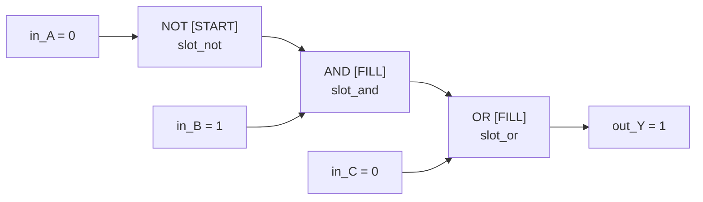
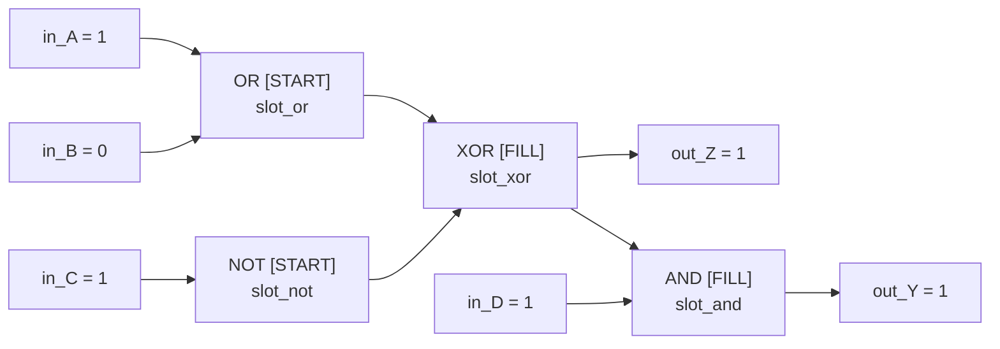
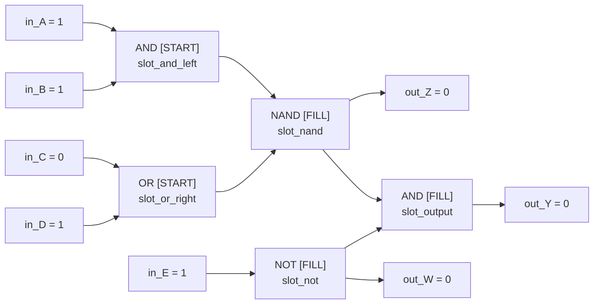
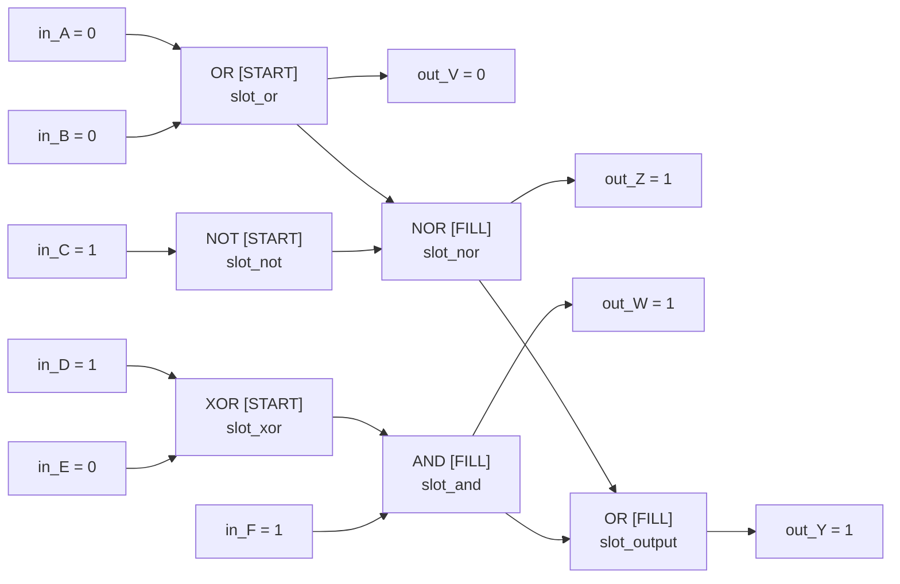
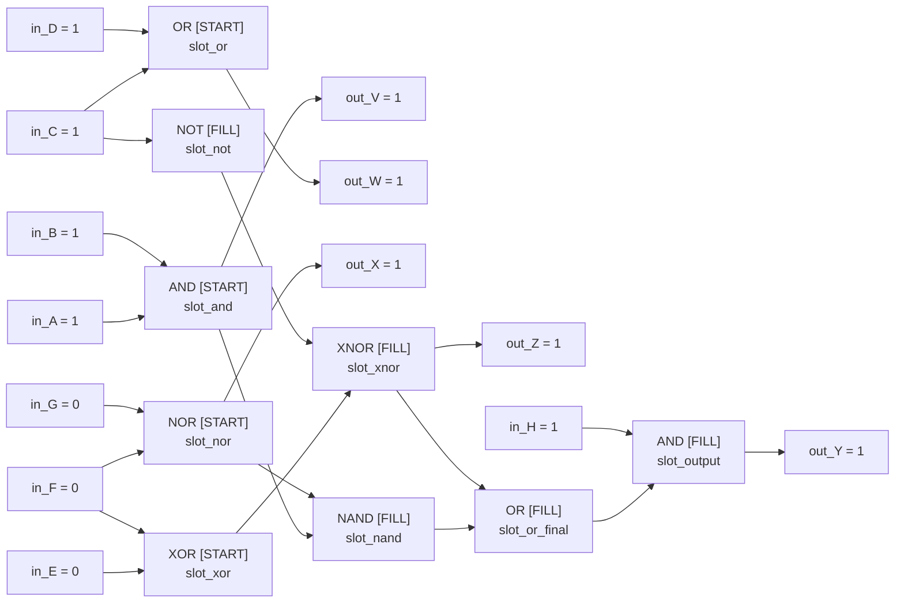

# Level Circuit Diagrams

These diagrams show the intended circuit wiring for each level. `[START]`
means the gate is already placed when the level begins. `[FILL]` means the
slot starts empty and the player must place that gate. Every output light is a
declared target, including intermediate outputs.

## Level 1: Logic Gate Foundations

Inputs: `in_A=0`, `in_B=1`, `in_C=0`  
Target: `out_Y=1`

## Level 2: Spot the Difference

Inputs: `in_A=1`, `in_B=0`, `in_C=1`, `in_D=1`  
Targets: `out_Z=1`, `out_Y=1`

## Level 3: The Inverted Combination

Inputs: `in_A=1`, `in_B=1`, `in_C=0`, `in_D=1`, `in_E=1`  
Targets: `out_Z=0`, `out_W=0`, `out_Y=0`

## Level 4: A Quiet Signal

Inputs: `in_A=0`, `in_B=0`, `in_C=1`, `in_D=1`, `in_E=0`, `in_F=1`  
Targets: `out_V=0`, `out_Z=1`, `out_W=1`, `out_Y=1`

## Level 5: The Complete Circuit

Inputs: `in_A=1`, `in_B=1`, `in_C=1`, `in_D=1`, `in_E=0`, `in_F=0`, `in_G=0`, `in_H=1`  
Targets: `out_V=1`, `out_W=1`, `out_X=1`, `out_Z=1`, `out_Y=1`

